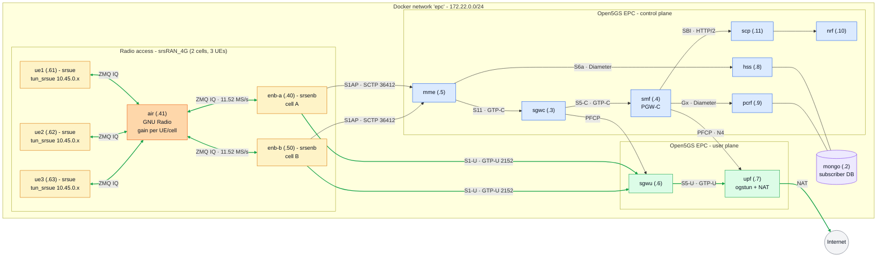

# 4G LTE Stack: Architecture & Validation Guide

This document explains the fully-virtual 4G LTE network in `deploy/4g/`: what each container does, how they connect, and how to bring the stack up and validate. The validation consists of the one-shot `make 4g-auto` acceptance test and by performing each step manually so you can watch the signaling happen.

It maps directly onto the theory in [`THEORY.md`](THEORY.md) (Chapters "4G Components", "LTE Data Plane", "LTE Control Plane", and "LTE Association and mobility").

> **No RF, no radio law.** There is no over-the-air transmission. The "radio" between the base station and the phone is a virtual link carrying IQ samples over TCP (ZeroMQ). The "phone" is a software UE. Everything runs in Docker on one host.

---

## 1. What the stack is

Two open-source projects, built from source into local images (see `deploy/images/`):

- **Open5GS**: the mobile core (EPC). Provides every 4G network function.
- **srsRAN_4G**: the radio access side: a software eNodeB (`srsenb`) and a software UE (`srsue`) that talk to each other over a **ZMQ virtual radio** instead of real RF.

A single **MongoDB** stores subscriber records (the "SIM database").

All services for now run on one Docker bridge network, `172.22.0.0/24`, with **static IPs** so that Diameter, GTP-U, PFCP and SBI endpoints are deterministic (see the IP map below).

---

## 2. Architecture



Blue = control plane (signaling), green = user plane (the actual data path), orange = radio access (the GNU Radio "air" sits on the virtual-radio path between both eNBs and all UEs: every UE hears every cell through a gain that depends on the distance, see `parts/3-handover.md`). All three UEs share the one (unchanged) EPC.

**A deliberate deviation from a real UE:** each `ue`/`ue1`/`ue2`/`ue3` container has a second interface, `eth0`, that a real phone has no equivalent of. In this lab it exists only to carry the simulated ZMQ RF link to the air over the `epc` Docker network. Left alone, that network gives every container real internet access via Docker's own NAT, independent of anything happening at the cellular layer, which would make `telcoctl suspend` (which tears down the S1-U/GTP bearer) invisible to a UE using ordinary, non interface-bound traffic. `deploy/4g/scripts/ue-entrypoint.sh` closes that gap: `eth0` is iptables-locked to the `epc` subnet only (the RF link keeps working, nothing else can leave via it), and a default route via `tun_srsue` is maintained for as long as the PDU session is up. Net effect: internet reachability is gated entirely by the cellular attach state, matching a real phone having no data path at all while detached or barred (not a degraded one).

**A suspended UE recovers on its own once resumed, no container recreate involved.** `suspend`'s live detach only tears down the S1-U/GTP bearer and NAS/EMM session, it never touches the ZMQ radio link, so the `enb`/`ue`/`air` processes stay up throughout. The UE's own NAS stack retries attaching immediately per `REATTACH_REQUIRED`; while still suspended that retry is rejected (EMM cause #8), and the UE falls back to periodically retrying via the 3GPP `T3402` timer until an attempt succeeds (`srsue/src/stack/upper/nas.cc`'s `parse_attach_reject`, `t3402_duration_ms` in `nas.h` has been shortened to 15s in this lab; spec default is 12 minutes). `resume` a subscriber and the UE typically regains connectivity within ~20-25s on its own, with no effect on other UEs sharing its cell.

### IP / port map

| Service | IP | Role | Key interfaces |
|---|---|---|---|
| `mongo` | 172.22.0.2 | Subscriber database (the SIM store) | MongoDB 27017 |
| `sgwc`  | 172.22.0.3 | Serving GW control plane | GTP-C, PFCP |
| `smf`   | 172.22.0.4 | Session Mgmt (PGW-C): IP alloc, sessions | GTP-C, PFCP, Gx, SBI |
| `mme`   | 172.22.0.5 | Mobility Mgmt: control-plane brain | S1AP 36412, S11, S6a |
| `sgwu`  | 172.22.0.6 | Serving GW user plane | GTP-U 2152 |
| `upf`   | 172.22.0.7 | User Plane (PGW-U): the gateway to the Internet | GTP-U, `ogstun`, NAT |
| `hss`   | 172.22.0.8 | Home Subscriber Server: auth + subscriber data | S6a (Diameter) |
| `pcrf`  | 172.22.0.9 | Policy & Charging Rules | Gx (Diameter) |
| `nrf`   | 172.22.0.10 | NF Repository (service discovery, 5G-style) | SBI (HTTP/2) |
| `scp`   | 172.22.0.11 | Service Communication Proxy | SBI (HTTP/2) |
| `enb-a` | 172.22.0.40 | Software eNodeB (cell A base station) | S1AP, S1-U, ZMQ |
| `air` | 172.22.0.41 | GNU Radio "air": mixes every cell into every UE and back, with a gain per UE/cell | ZMQ IQ, control API 8090 |
| `enb-b` | 172.22.0.50 | Software eNodeB (cell B base station) | S1AP, S1-U, ZMQ |
| `ue1`   | 172.22.0.61 | Software UE on cell A (the "phone") | ZMQ, `tun_srsue` |
| `ue2`   | 172.22.0.62 | Software UE on cell A | ZMQ, `tun_srsue` |
| `ue3`   | 172.22.0.63 | Software UE on cell B | ZMQ, `tun_srsue` |
---

## 3. Role of each container

### Core: control plane

- **`mme` (Mobility Management Entity).** The control-plane brain. Terminates S1AP from the eNB, runs the NAS Attach procedure, authenticates the UE (fetching vectors from the HSS over **S6a/Diameter**), and sets up the data path via **S11/GTP-C** to the SGW-C. No user data flows through it. This maps to `THEORY.md` chapters "4G Components" and "LTE Signaling".
- **`hss` (Home Subscriber Server).** The subscriber/auth database front-end. Reads subscriber records (IMSI, Ki, OPc, APN, QoS) from MongoDB and answers the MME's S6a authentication and location queries. The 4G equivalent of the 2G HLR.
- **`pcrf` (Policy and Charging Rules Function).** Supplies QoS/charging policy to the SMF over **Gx/Diameter** when the default bearer is created.
- **`sgwc` (Serving Gateway – Control).** Control half of the SGW after CUPS split; relays session setup between MME (S11) and SMF (S5-C), and controls the SGW-U via PFCP.
- **`smf` (Session Management Function / PGW-C).** Allocates the UE's IP address (`10.45.0.0/16`), creates the PDN session/default bearer, pulls policy from PCRF (Gx), and controls the UPF via **PFCP (N4)**. This maps to `THEORY.md` chapter "4G EPC vs. 5G Core" (SMF = MME session part + PGW-C).
- **`nrf` / `scp`.** Open5GS's SMF/UPF are shared with its 5G core and use a Service-Based Interface. The **NRF** is the service-discovery registry and the **SCP** is the proxy the SMF registers through. They are required for the SMF to start cleanly even in a 4G-only deployment. This maps to `THEORY.md` chapter "5G Service-Based Architecture".

### Core: user plane

- **`sgwu` (Serving Gateway – User).** User-plane anchor between the eNB (S1-U) and the UPF (S5-U). Forwards GTP-U tunnelled traffic. Controlled by the SGW-C over PFCP.
- **`upf` (User Plane Function / PGW-U).** The exit to the Internet. Creates the `ogstun` TUN device, owns the UE IP pool gateway `10.45.0.1/16`, decapsulates GTP-U, and **NATs** UE traffic out to the real Internet (`iptables MASQUERADE`). This maps to `THEORY.md` chapters "LTE Data Plane" and "Tunneling (GTP)".

### Radio access

- **`enb-a`, `enb-b` (srsenb - software eNodeBs).** Two base stations, one per cell. Each connects to the MME over **S1AP** (SCTP 36412), carries user data over **S1-U/GTP-U**, and broadcasts the cell its UEs camp on. Their "radio" front-end is the ZMQ driver (as we have no real RF hardware); their configs are `config/multi/enb-a.conf` / `enb-b.conf`.
- **`air` (GNU Radio, `deploy/4g/broker/`).** The shared virtual radio. A raw ZMQ link is point-to-point, so the air is what lets **several UEs share one eNB** and **one UE hear two eNBs**: each UE receives the sum of both cells' downlink and each eNB the sum of all UEs' uplink, every link weighted by a gain that follows from the distance between UE and cell. It also keeps the positions of cells and UEs, moves UEs (`make 4g-travel`) and serves a small control API on port 8090. All RF endpoints run at `base_srate = 11.52 MS/s`, and the air must start **after** the eNBs and UEs (see §5.4).
- **`ue1`, `ue2`, `ue3` (srsue - software UEs).** The "phones": `ue1`+`ue2` start on cell A, `ue3` on cell B, and any of them can travel to the other cell (handover). Each runs the real UE-side stack (PHY→MAC→RLC→PDCP→RRC + NAS). Its USIM credentials live in its own `config/multi/ue*.conf`, where **this file is the actual eSIM profile**. On successful attach it creates a `tun_srsue` interface with the IP the UPF assigned. → `THEORY.md` §"LTE Association and mobility".

### Database

- **`mongo`.** Stores the subscriber documents. For now provisioned by `deploy/4g/scripts/add-subscriber.sh` (a thin wrapper over the vendored `open5gs-dbctl`). In Plan 2 this is replaced by our own Go `provisioner`.

---

## 4. The "SIM" and authentication

The subscriber is defined by values that must match on **both** sides:

| Value | What it is | Where in the core | Where in the UE |
|---|---|---|---|
| IMSI `999700000000001` | The subscriber's globally unique identity number. | `mongo` subscriber doc | `ue.conf` `[usim] imsi` |
| Ki `465B5CE8...A6BC` | The subscriber's secret authentication key, never transmitted over the air. | `mongo` subscriber doc | `ue.conf` `[usim] k` |
| OPc `E8ED289D...83CA` | Operator-specific key material combined with Ki to derive session keys. | `mongo` subscriber doc | `ue.conf` `[usim] opc` |
| PLMN `MCC 999 / MNC 70` | The identifier (country + network code) of the mobile network operator. | `mme.yaml` gummei+tai | `ue.conf` IMSI prefix + `enb.conf` mcc/mnc |
| APN `internet` | The packet data network the UE requests to be connected to. | subscriber doc + `smf.yaml` | `ue.conf` `[nas] apn` |


If Ki/OPc disagree, the Attach fails at **Authentication**. If the PLMN/TAC disagree, the eNB's **S1 Setup** is rejected before any UE can attach (see Troubleshooting).

---

## 5. Running the infra

### 5.1 Automated validation (quick)

This performs the following from a clean state automatically: build, start the full **2-cell / 3-UE** topology (see §5.4), provision the 3 subscribers, wait for every UE to attach, and ping `8.8.8.8` from each through the UPF. From the repo root do the following:

```bash
make 4g-auto
```


A successful automatic deployment looks like:

```yaml
...
Provisioned subscriber 999700000000001 (APN=internet)
./deploy/4g/scripts/wait-for-attach.sh
UE attached:  inet 10.45.0.2/24 scope global tun_srsue
docker compose -f deploy/4g/docker-compose.yml exec -T ue ping -I tun_srsue -c 4 8.8.8.8
PING 8.8.8.8 (8.8.8.8) from 10.45.0.2 tun_srsue: 56(84) bytes of data.
64 bytes from 8.8.8.8: icmp_seq=1 ttl=126 time=66.9 ms
64 bytes from 8.8.8.8: icmp_seq=2 ttl=126 time=32.4 ms
64 bytes from 8.8.8.8: icmp_seq=3 ttl=126 time=45.5 ms
64 bytes from 8.8.8.8: icmp_seq=4 ttl=126 time=52.0 ms

--- 8.8.8.8 ping statistics ---
4 packets transmitted, 4 received, 0% packet loss, time 3002ms
rtt min/avg/max/mdev = 32.363/49.196/66.854/12.416 ms
```

Tear down with:

```bash
make 4g-auto-down      # stops containers and removes the mongo volume
```

### 5.2 Partially staged deployment (infra, subscribers, devices)

As a middle ground between the one-shot `make 4g-auto` and the fully by-hand walkthrough in §5.3, the deployment is also split into an **infra** stage, a **subscribers** stage, and a **devices** stage on the multi-cell topology. Each prints what it is doing and which containers it starts/stops. These sit *alongside* the manual steps, not instead of them:

```bash
make 4g-infra             # EPC core + both eNBs — the operator network, NO subscribers, NO UEs
make 4g-demo-subscribers  # provision the 3 fixed subscribers with the telcoctl client
make 4g-devices           # then the 3 devices: ue1+ue2+ue3 + the air, wait for attach, ping all

make 4g-devices-down      # remove the 3 devices + the air (core, eNBs and subscribers keep running)
make 4g-auto-down         # tear the whole stack down (infra is the foundation, so the UEs go too)
```

`make 4g-infra` deliberately provisions **nothing**, it just stands up the network (EPC core + both eNBs), the way a real operator's network exists before any SIM is sold. Subscribers are then created through the `telcoctl` client (`make 4g-infra` prints how to drive it). `make 4g-demo-subscribers` is a convenience that provisions the three fixed subscribers whose keys match `config/multi/ue*.conf`, so the devices can attach. From there, `make 4g-devices` brings up all three devices (`ue1`+`ue2` near `enb-a`, `ue3` near `enb-b`) with the air started last. It restarts the eNBs too. The virtual radio has no timestamps, so all radio endpoints have to start together (the core and the subscribers stay). Starting a single device on its own is not possible yet; that is the "hot-join" step on the roadmap.

---

### 5.3 Complete manual validation

With the steps below you can perform the automatic validation steps manually to see what happens between the components.


#### 5.3.1 First only start the core

```bash
docker compose -f deploy/4g/docker-compose.yml up -d mongo provisioner nrf scp hss pcrf sgwc sgwu upf smf mme
docker compose -f deploy/4g/docker-compose.yml ps
```

All services should be `running` and `mongo` should say `healthy`.


#### 5.3.2 Confirm the core's internal links came up

**Diameter (S6a MME - HSS, Gx SMF - PCRF):**
```bash
docker compose -f deploy/4g/docker-compose.yml logs mme hss smf pcrf | grep "CONNECTED TO"
```
Expect four lines: MME - `hss.localdomain`, HSS - `mme.localdomain`, SMF - `pcrf.localdomain`,
PCRF - `smf.localdomain`.

**PFCP (SGW-C - SGW-U, SMF - UPF):**
```bash
docker compose -f deploy/4g/docker-compose.yml logs | grep "PFCP associated"
```

Expect associations between `.3 - .6` and `.4 - .7`.

**SBI (SMF registers with NRF via SCP):**
```bash
docker compose -f deploy/4g/docker-compose.yml logs smf | grep "NF registered"
```

#### 5.3.3 Provision a subscriber

```bash
make telcoctl   # builds ./bin/telcoctl, if not already built

TELCOCTL_SERVER=http://127.0.0.1:8080 TELCOCTL_TOKEN=dev-operator-token \
  ./bin/telcoctl add --imsi 999700000000001 \
    --ki 465B5CE8B199B49FAA5F0A2EE238A6BC \
    --opc E8ED289DEBA952E4283B54E88E6183CA \
    --apn internet --reason NEW_ACTIVATION

# verify:
TELCOCTL_SERVER=http://127.0.0.1:8080 TELCOCTL_TOKEN=dev-operator-token ./bin/telcoctl list
```

For the full operator-side lifecycle (provisioning via `telcoctl`, and suspending/resuming a live subscriber) on the multi-UE demo topology, see [`docs/scenarios/suspend-resume.md`](scenarios/suspend-resume.md).

#### 5.3.4 Start the (software based) radio

Order matters for the ZMQ link. We need to start the eNB, give it a moment, then start the UE:

```bash
docker compose -f deploy/4g/docker-compose.yml up -d enb
sleep 4
docker compose -f deploy/4g/docker-compose.yml up -d ue
```

**Watch the eNB attach to the core:**
```bash
docker compose -f deploy/4g/docker-compose.yml logs enb | grep -i "S1SetupResponse"
```

**Watch the UE camp, connect, and attach:**
```bash
docker compose -f deploy/4g/docker-compose.yml logs ue | grep -iE "Found Cell|Found PLMN|RRC Connected|Random Access Complete|Network attach successful"
```

Expect (this is the LTE initial-attach sequence mentioned in `THEORY.md` chapter "LTE Association"):
```yaml
Found Cell:  Mode=FDD, PCI=1, PRB=50 ...
Found PLMN:  Id=99970, TAC=1
RRC Connected
Random Access Complete.     c-rnti=0x46, ta=0
Network attach successful. APN: internet, IP: 10.45.0.2
```

**Confirm the core saw the attach:**
```bash
docker compose -f deploy/4g/docker-compose.yml logs mme | grep -iE "Attach request|Attach complete"
```

#### 5.3.5 Prove the data plane end-to-end

The UE now has a routable interface, so we can send real traffic through the UPF:

```bash
# ICMP to the Internet through tun_srsue
docker compose -f deploy/4g/docker-compose.yml exec -T ue ping -I tun_srsue -c 4 8.8.8.8

# DNS + HTTP through the tunnel
docker compose -f deploy/4g/docker-compose.yml exec -T ue sh -c "curl -s --interface tun_srsue https://ifconfig.me; echo"
```

The full path exercised: `srsue → ZMQ → srsenb → S1-U/GTP-U → SGW-U → S5-U → UPF → ogstun → NAT → Internet`, with the return path reversed. This is GTP-over-UDP tunnelling in action (mentioned in `THEORY.md` chapter "Tunneling in the LTE data plane").

`--interface tun_srsue`/`-I tun_srsue` above is there to be explicit about which path is under test, not because it's required: `ue-entrypoint.sh` maintains a default route via `tun_srsue` for as long as the UE is attached, and `eth0` can never reach the internet (see §2), so ordinary unbound traffic (`ping 8.8.8.8` with no `-I`) takes the same tunnel path automatically, and fails outright the moment the subscriber is suspended.

**Tools on the UEs.** Every UE can be used like a phone from a shell (`docker exec -it <ue container> bash`):

| Tool | For |
|---|---|
| `ping`, `curl`, `wget` | Reachability and HTTP(S) |
| `dig`, `nslookup` | DNS lookups |
| `iperf3` | Throughput, e.g. `iperf3 -c iperf.he.net -R -t 10` (`-R`: the server sends, so you measure the downlink) |
| `traceroute`, `tracepath`, `mtr` | The path packets take, hop by hop |
| `nc` | Open a raw TCP/UDP connection, e.g. `nc -zv example.com 443` |
| `tcpdump` | Watch what goes in and out of `tun_srsue` |

DNS also goes through the cellular network: `ue-entrypoint.sh` points `/etc/resolv.conf` at the DNS servers the network hands out (`8.8.8.8` and `1.1.1.1`, from `smf.yaml`). Without that, Docker's own resolver (`127.0.0.11`) would answer from the host, and name lookups would keep working while the UE has no service.

Try it yourself:

1. **Where does the tunnel end?** `traceroute -n 8.8.8.8`. The first hop is `10.45.0.1`: the UPF, where the GTP tunnel ends. The eNB and the SGW-U are not hops at all, as they only carry the packet inside the tunnel. Compare with `tracepath -n 8.8.8.8`, which also reports the path MTU.
2. **The MTU.** `smf.yaml` gives the UEs an MTU of 1400, but `tun_srsue` is set to 1500 (`ip link show tun_srsue`). Find the largest ping that gets through unfragmented with `ping -M do -s <size> 8.8.8.8`, and work out where the 36 bytes of GTP-U overhead (§6, Action 1) go.
3. **How fast is the virtual radio?** `iperf3 -c iperf.he.net -R -t 10`, then without `-R` for the uplink. Expect well under 1 Mbit/s: the radio runs at about a tenth of real time on a busy host (see `experiments/1-radio-stability.md`), even though a 25 PRB cell can carry far more.
4. **Watch the tunnel from the inside.** In one shell `tcpdump -n -i tun_srsue`, in another `curl -sI https://example.com`. You see the DNS query, the TCP handshake and the TLS session as plain IP packets: the UE never sees GTP, that only exists between the eNB and the core.
5. **Your public address.** `curl -s https://ifconfig.me`. That is not the UE's `10.45.0.x` address, but the address the UPF's NAT (and your own router) put on the traffic.

#### 5.3.6 Inspect live state (optional)

```bash
# UE IP and interface
docker compose -f deploy/4g/docker-compose.yml exec -T ue ip addr show tun_srsue

# UPF tunnel device and NAT
docker compose -f deploy/4g/docker-compose.yml exec -T upf ip addr show ogstun
docker compose -f deploy/4g/docker-compose.yml exec -T upf iptables -t nat -L POSTROUTING -n
```

### 5.4 Multiple UEs and cells (the shared air)

The single-UE paths above use a direct point-to-point ZMQ link between one eNB and one UE, which is why only one UE can attach (see §7.2). To run **several UEs on the same eNB** and **more than one eNB**, a GNU Radio flowgraph, the **air**, sits between all of them: each eNB receives the sum of all UEs' uplink I/Q and each UE the sum of both eNBs' downlink, every link weighted by a gain (details in `parts/2-multi-ue-broker.md`).

The demo topology is **2 cells, 3 UEs** (`ue1`+`ue2` near `enb-a`, `ue3` near `enb-b`), all sharing the one (unchanged) EPC:

```bash
make 4g-multi           # core → provision 3 subscribers → eNBs → UEs → the air (LAST)
make status-4g          # watch the 3 UEs attach
make test-4g-multi      # acceptance: all 3 attach + ping concurrently; 2 share enb-a
make 4g-travel          # move UEs between the cells (handover, dead zone, Faraday cage)
make test-4g-handover   # acceptance: ue2 travels A → B → A with a ping running
make map                # the world map on http://127.0.0.1:8088 (parts/4-world-map.md)
make 4g-auto-down       # tear it all down
```

Key points: the **air must start after** the eNBs and UEs and be **restarted whenever the radio side restarts** (the `make` targets handle the ordering). Every RF component shares `base_srate=11.52e6` (25 PRB). Each UE has its own IMSI/keys (`config/multi/ue*.conf`, provisioned by `scripts/provision-multi.sh`), its own container IP, and its own `tun_srsue`. Moving UEs between the cells (S1 handover) is in `parts/3-handover.md`; why the radio needed hardening first is in `experiments/1-radio-stability.md`.

---

## 6. Packet capture for Wireshark

The stack can record `.pcap` files at two levels so you can dissect the entire call flow offline in Wireshark. Captures are **optional**, as they don't run during a normal `make up-4g` or `make 4g-auto`. and wo;; land in `deploy/4g/pcap/` (which is git-ignored).

### What gets captured

**Radio + NAS (srsRAN built-in, via `[pcap]` in `enb.conf` / `ue.conf`):**

| File | Written by | Contents | Wireshark |
|---|---|---|---|
| `ue_mac.pcap` | `ue` | LTE MAC PDUs (scheduling, RA, HARQ) | MAC-LTE dissector |
| `ue_nas.pcap` | `ue` | NAS-EPS: Attach, Auth, Security Mode, ESM | NAS-EPS (link-type 148) |
| `enb_mac.pcap` | `enb` | LTE MAC PDUs from the eNB side | MAC-LTE dissector |
| `enb_s1ap.pcap` | `enb` | S1AP over the eNB's S1 link | S1AP dissector |

These layers are **not IP packets**, so only srsRAN can emit them. This is how you see the RRC/NAS attach sequence (mentioned in `THEORY.md` chapters "LTE Control Plane" and "LTE Association").

**Core IP interfaces (tcpdump sidecars, one per NF, sharing its network namespace):**

| File | NF | Interfaces captured | Protocols |
|---|---|---|---|
| `core_mme.pcap`  | `mme`  | S1AP, S6a, S11 | SCTP (S1AP :36412, Diameter), GTP-C (:2123) |
| `core_smf.pcap`  | `smf`  | S5-C, Gx, N4, SBI | GTP-C (:2123), Diameter (SCTP), PFCP (:8805), HTTP/2 (:7777) |
| `core_sgwu.pcap` | `sgwu` | S1-U, S5-U, N4 | GTP-U (:2152), PFCP (:8805) |
| `core_upf.pcap`  | `upf`  | S5-U, N4, N6/ogstun | GTP-U (:2152), PFCP (:8805), decapsulated user IP/ICMP |

### How to capture

```bash
make capture-4g        # builds, starts the stack WITH capture, provisions, attaches, pings
# ... run the actions from "Actions to try during a capture" below ...
make capture-stop-4g   # flushes & stops the capture sidecars + eNB/UE, lists the .pcap files
```

> **Why should you do an explicit stop?** The MAC and core (tcpdump) captures stream to disk live, but the **NAS** pcap is buffered by srsue and only flushed on a clean shutdown. `make capture-stop-4g` stops the UE gracefully so `ue_nas.pcap` is complete.

### Actions to try during a capture

`make capture-4g` only records one attach and four pings. After that, the capture only collects keepalives (PFCP heartbeats and Diameter watchdogs), so run the actions below before `make capture-stop-4g` to get more call flows into the PCAPs. These actions use `ping`, `dig` and `curl` for user traffic and `telcoctl` for operator events (see §5.3.5 for all the tools on the UE).

Capture only runs on the single-cell stack, so everything here uses `ue` and its subscriber. Run the actions in this order, as action 4 builds on action 3. First set up your shell:

```bash
make telcoctl          # Make the provisioning tool if not yet done
export TELCOCTL_TOKEN=dev-operator-token
IMSI=999700000000001
UE=telecom-poc-4g-ue-1
```

> **Keep in mind:**
> - `core_mme.pcap` shows most NAS messages after Security Mode as `Ciphered message`, because the MME prefers EEA2 (see `deploy/4g/config/mme.yaml`). You can tell these messages apart by their position in the flow.
> - The first `telcoctl get` can show `1000000000bps` and `plan not yet applied, reattach pending`. This is only a display quirk, as `make capture-4g` adds this subscriber with `add-subscriber.sh` instead of the provisioner. The message goes away after action 3.
> - `ue_nas.pcap` currently stays empty, so all of the actions below use the core PCAPs.

#### Action 1: Send a larger ping

```bash
docker exec $UE ping -I tun_srsue -s 1400 -c 5 8.8.8.8
```

Open `core_upf.pcap` and filter on `data.len > 1300`. Each ping shows up twice: once as a 1464-byte packet with GTP-U around it, and once as the 1428-byte original after the UPF removed the tunnel. Those extra 36 bytes are the outer IP (20), UDP (8) and GTP-U (8) headers. Nothing gets fragmented at this size.

#### Action 2: Let the UE go idle, then wake it up

```bash
sleep 60                                    # no traffic, so the eNB releases the UE (took ~45s in our test)
docker exec $UE ping -I tun_srsue -c 3 8.8.8.8
```

Open `core_mme.pcap` and filter on `s1ap || gtpv2`:

| Step | What you see |
|---|---|
| UE goes idle | `UEContextReleaseRequest [user-inactivity]` → `Release Access Bearers` → `UEContextReleaseCommand` / `Complete` |
| Ping wakes it up | `InitialUEMessage, Service request` → `InitialContextSetupRequest` / `Response` → `Modify Bearer` |

The UE stays attached and there is no new authentication or session: only the radio connection and the S1-U bearer are torn down and rebuilt. The first ping is also noticeably slower than the rest (up to 363 ms against ~40 ms in our test).

#### Action 3: Change the subscriber's plan

```bash
./bin/telcoctl set-plan $IMSI --dl 5M --ul 2M --reason DOWNGRADE
```

Open `core_mme.pcap` and filter on `diameter.cmd.code == 319` to see the HSS sending `Insert-Subscriber-Data` to the MME. Then filter on `s1ap || diameter || gtpv2`: no S1AP message follows it, so the eNB never hears about the new plan. `docs/scenarios/2-change-subscriber-plan.md` explains why.

#### Action 4: Suspend the subscriber, then resume it

```bash
./bin/telcoctl suspend $IMSI --reason MAINTENANCE --note "capture exercise"
# Wait for a failed ping, which proves the detach landed. Never resume straight after a suspend.
while docker exec $UE ping -I tun_srsue -c 1 -W 1 8.8.8.8 >/dev/null 2>&1; do sleep 1; done
sleep 10                                    # gives the UE time to try (and fail) to reattach

./bin/telcoctl resume $IMSI --reason CLEARED --note "capture exercise"
until docker exec $UE ping -I tun_srsue -c 1 -W 2 8.8.8.8 >/dev/null 2>&1; do sleep 1; done
```

The reattach took about 23 seconds after the `resume` in our test, and can take up to about a minute. See `docs/scenarios/1-suspend-resume-subscriber.md` for the operator's view of this flow.

Open `core_mme.pcap` and filter on `s1ap || diameter || gtpv2`:

| Step | What you see |
|---|---|
| Live detach | `Cancel-Location` (S6a) → `Delete Session` → `DownlinkNASTransport, Ciphered message` (the Detach Request) → `UEContextReleaseCommand [detach]` |
| UE tries to reattach | `Attach request` → `Identity request` / `response` → `Authentication-Information` → `Attach reject`, then repeated. There is no `Authentication request`, as the HSS already refused the subscriber |
| After the resume | A complete attach, the same as the very first one |

Some useful filters for this action:

| Goal | Filter | PCAP |
|---|---|---|
| Only the HSS cancelling the UE | `diameter.cmd.code == 317` | `core_mme.pcap` |
| Only the rejected attaches (cause #8) | `nas_eps.nas_msg_emm_type == 0x44` | `core_mme.pcap` |
| The new plan reaching the eNB | `s1ap.uEaggregateMaximumBitRateDL` | `core_mme.pcap` |
| Session setup and teardown, without heartbeats | `gtpv2 \|\| (pfcp && pfcp.msg_type != 1 && pfcp.msg_type != 2)` | `core_smf.pcap` |

The third filter finishes the story from action 3. Expand the UE-AMBR in each `InitialContextSetupRequest`: the earlier ones still carry `1000000000`, and the one from the reattach carries `5000000` down and `2000000` up. That is the moment the plan change actually reaches the radio side.

#### Action 5: Look up a name and fetch a page

```bash
docker exec $UE dig example.com
docker exec $UE curl -sI https://example.com
```

Open `core_upf.pcap` and filter on `dns`: the query to `8.8.8.8` shows up inside GTP-U (Wireshark decodes the inner packet) and again after the UPF removed the tunnel, just like the ping in action 1. Then filter on `tls.handshake.type == 1` to find the TLS Client Hello and expand its Server Name: the operator can see which site the UE visits, even though the page itself is encrypted.

### Analyzing the PCAPs in Wireshark

Open one of the PCAPs like:
```bash
wireshark deploy/4g/pcap/core_smf.pcap
```

Useful display filters to see the correct type of traffic per PCAP:

| Goal | Filter |
|---|---|
| The NAS attach exchange | `nas-eps` (open `ue_nas.pcap`) |
| eNB↔MME setup + UE context | `s1ap` (open `core_mme.pcap` or `enb_s1ap.pcap`) |
| Session creation / bearer setup | `gtpv2` |
| User-plane tunnelled traffic | `gtp` (GTP-U, open `core_sgwu.pcap`) |
| Control of the user plane | `pfcp` |
| Authentication over S6a | `diameter` |
| 5G-style service registration | `http2` (open `core_smf.pcap`) |
| The UE's actual pings, decapsulated | `icmp` (open `core_upf.pcap`) |

A good first exercise: open `core_mme.pcap`, filter `s1ap || diameter`, and follow `S1SetupRequest → InitialUEMessage(Attach) → Authentication-Information (S6a) → InitialContextSetup → Attach Complete` - the whole control-plane attach in one view.

---

## 7. Troubleshooting

### 7.1 When building the initial 4G stack

The following are issues that we hit while building this whole 4G stack:

- **eNB S1 Setup rejected: `Cannot find Served TAI` / `unknown-PLMN`.** The eNB's Tracking Area Code (in `deploy/4g/config/rr.conf`, `tac`) must match the MME's served TAI (`deploy/4g/config/mme.yaml`, `mme.tai.tac`). Both are set to `1` here. A mismatch rejects the eNB before any UE can attach.

- **UE stuck at `Switching on`, never finds the cell - after a `docker compose restart`.** `restart` can leave stale ZMQ socket state and the `fail_on_disconnect` eNB radio out of sync. Fix: recreate cleanly, eNB first:

```bash
docker compose -f deploy/4g/docker-compose.yml up -d --force-recreate enb
sleep 4
docker compose -f deploy/4g/docker-compose.yml up -d --force-recreate ue
```

- **Diameter peers won't connect across containers.** The stock freeDiameter configs assume loopback (`ListenOn 127.0.0.x`, `ConnectTo 127.0.0.x`). `deploy/4g/scripts/diameter-entrypoint.sh` rewrites `ListenOn` to the container's static IP and `ConnectTo` to the peer's IP at startup. TLS is already disabled (`No_TLS`) in the stock peer definitions, so no certificates are involved.

- **UE authentication failure.** The Ki/OPc in `ue.conf` and the `mongo` subscriber doc disagree. Re-run `add-subscriber.sh` and check both use the values in §4.

- **`Failed to mlockall` / `real-time priority` warnings in the UE.** Harmless - the container lacks `IPC_LOCK`/`SYS_NICE`. ZMQ's relaxed timing tolerates normal priority.

- **`ue_nas.pcap` is empty (0 bytes).** Two causes: (1) the srsue `[pcap] enable` value must be a comma list of `mac,nas` - `mac_nas` is silently ignored; (2) the NAS capture only flushes on a clean UE shutdown, so stop it via `make capture-stop-4g` (not `kill -9`).


### 7.2 When building the Go-based provisioner

The following are issues that we hit while building the `provisioner` / `telcoctl` tooling (see `docs/provisioning.md` for the full walkthrough):

- **`suspend` didn't block anything, which meant that a "suspended" UE still attached and got an IP.** The obvious design (set the HSS `subscriber_status`/`operator_determined_barring` flag) is signaled but *not enforced*: **Open5GS v2.8.0's MME never reads `subscriber_status`** (zero references in `src/mme/`). Only *absence* from the live `subscribers` collection is enforced, the HSS then returns `USER_UNKNOWN` on the S6a request and the MME rejects the attach. Fix: `suspend` **moves** the subscriber document out of `subscribers` into a `suspended_subscribers` holding collection (all keys preserved, `subscriber_status` stamped as honest metadata) and `resume` moves it back. This makes it reversible, and it's the enforcement leg the MME actually honors. Verified with the MME running, no restart needed.

- **Milenage unit tests failed on `IK` only, while `RES`/`CK`/`AK` matched.** A hand-copied 3GPP TS 35.208 Test Set 1 known-answer literal was mistyped. The tell was that the `wmnsk/milenage` **oracle** cross-check (`TestF2345_MatchesOracle`) passed against the same inputs, which proved the implementation to be correct and the *expected* literal wrong. Fixed the literal to `f769bcd751044604127672711c6d3441`. Lesson: keep an independent oracle alongside static vectors so a typo in one doesn't read as an implementation bug.

- **Recreating the UE process against a still-running eNB doesn't cleanly re-pair.** Same stale-radio class of problem as in §7.1 above: a plain `docker compose restart ue` (or recreating only `ue`) leaves stale ZMQ socket state and a stale srsue GUTI/`.ctxt`. `deploy/4g/scripts/assert-attach-rejected.sh` recreates `enb`+`ue` together (`up -d --force-recreate enb ue`) once, before suspending, purely for a pristine starting NAS state. Ist's not needed for, and isn't used for, recovery after `resume`, which the UE handles on its own (see §2).

- **No live `CLR`/detach when suspending an already-attached UE.** Pushing a real **Cancel-Location-Request** to detach a live session needs the HSS's `use_mongodb_change_stream` *and* Mongo running as a replica set (a plain single node has no oplog to watch). The POC's stash-and-restore blocks the *next* attach without either; enabling the change stream + replica set is a documented later enhancement (see `docs/provisioning.md` §6).


**Known limitation: the ZMQ virtual radio is a single-UE point-to-point link.** The eNB and UE are wired directly to each other's IP, with the eNB's receive port pinned to the one UE:

```yaml
enb.conf: tx_port=tcp://*:2000, rx_port=tcp://172.22.0.21:2001, fail_on_disconnect=true
ue.conf:  tx_port=tcp://*:2001, rx_port=tcp://172.22.0.20:2000
```

Two consequences follow:

- **Restarting the UE process against a still-running eNB doesn't cleanly re-pair.** This is *not* about a UE attaching to a live eNB (which is the normal path and works fine). It's specifically that `fail_on_disconnect=true` faults the eNB's RF worker when the srsue process drops, so recreating only the UE leaves the eNB bound to a dead socket. Fix (as above): recreate the `enb`+`ue` **pair** together so the ZMQ link re-handshakes. Setting `fail_on_disconnect=false` may let the eNB tolerate a UE restart, but it can also leave the eNB streaming into a dead socket, so the tested recreate-both workaround is preferred for now. In multi-UE mode the same problem extends through the air: the stream has no timestamps, so a restarted endpoint cannot line up with the others again. A clean reconnect there means restarting the whole radio side (`make 4g-devices`: both eNBs, all UEs and the air; the core and subscribers stay).
- **Only one UE can exist on this link at a time.** The eNB's `rx_port` is bound to a single peer IP, so a *second* concurrent UE cannot join. This is a topology choice, not a dead end: multi-UE / multi-cell over ZMQ uses the shared **air** (a GNU Radio flowgraph that mixes the I/Q of all endpoints, see §5.4). That air is the RAN plumbing for **multiple eNodeBs + S1 handover** (`parts/3-handover.md`) and the later **multi-UE / roaming** work, and is out of scope for the provisioner plan (the HSS-side `suspend` enforcement is orthogonal to it).
